# Мой календарь

Android-календарь на Kotlin и Jetpack Compose: месяцы, недели и дни, события с напоминаниями,
повторами, метками, текстовыми и голосовыми заметками. События хранятся локально (Room) и
синхронизируются с **Google Календарём** через системный провайдер и с **Яндекс Календарём** по
CalDAV — в обе стороны.

Главное отличие от «ещё одного календаря» — **сохранность данных при конфликтах**: приложение
помнит последнее согласованное с облаком состояние каждого события, поэтому правки с двух сторон
не затирают друг друга, а раскладываются по полям и разбираются пользователем.

| | |
|---|---|
| 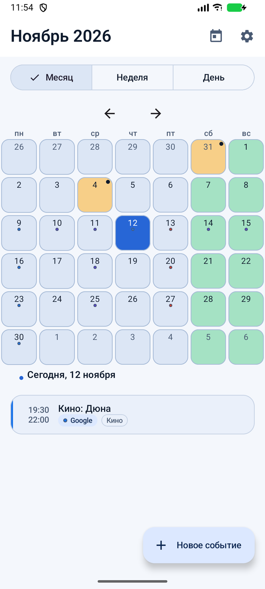 | 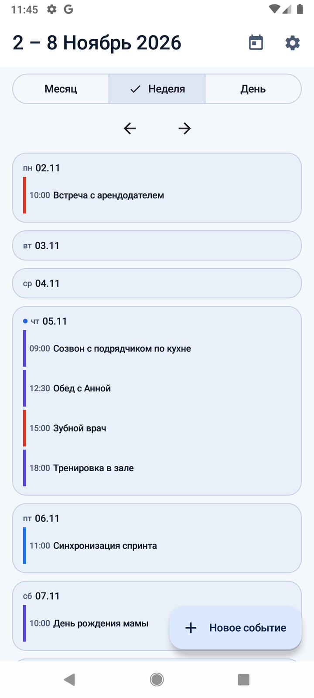 |
| Месяц с событиями | Неделя |
| 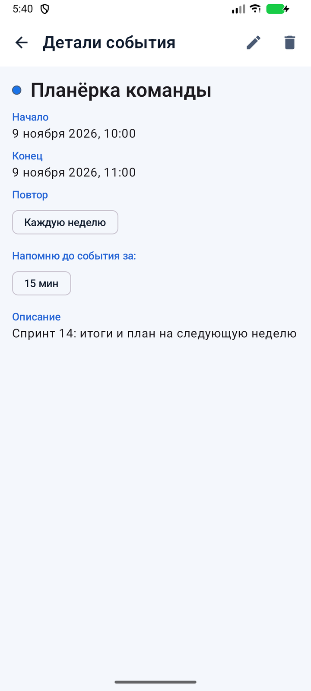 | 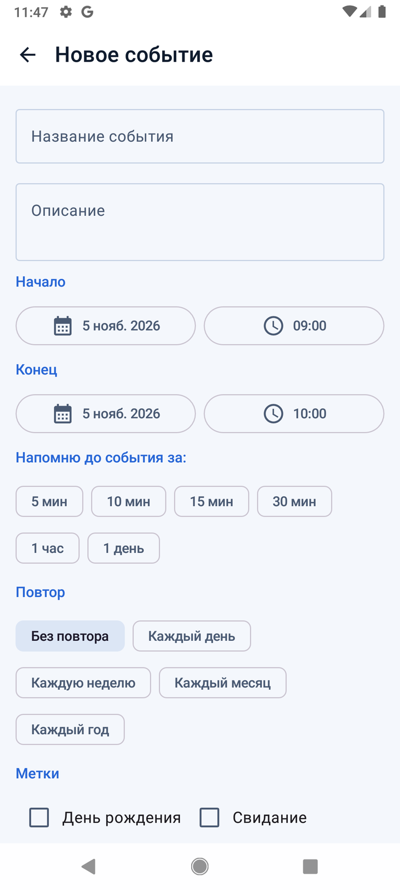 |
| Детали события с повтором | Редактор события |

| | | |
|---|---|---|
| 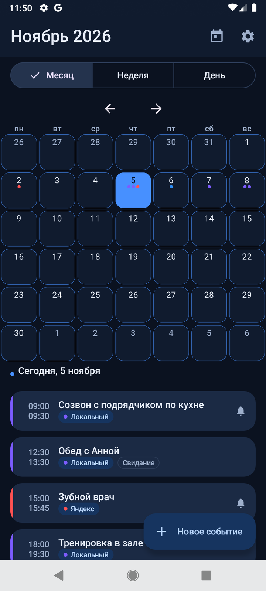 | 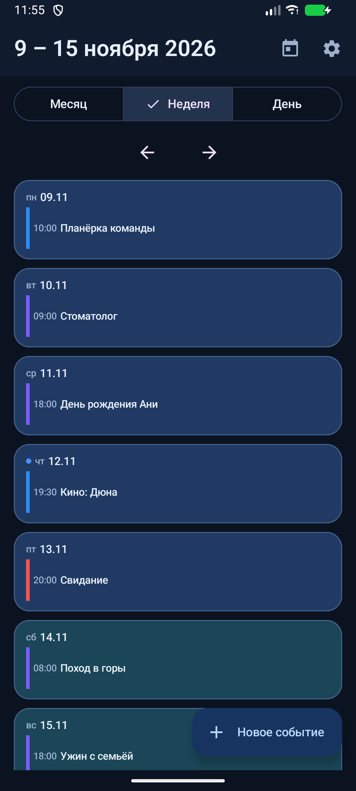 | 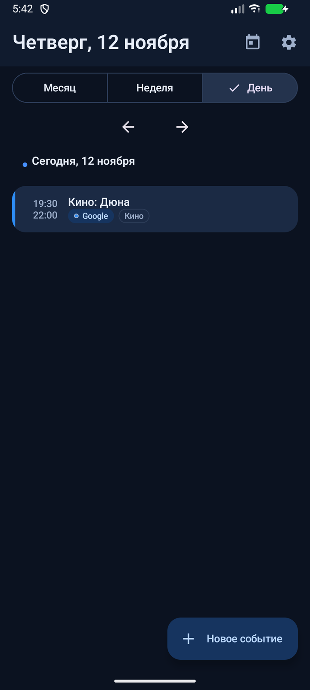 |
| Месяц | Неделя | День |
| 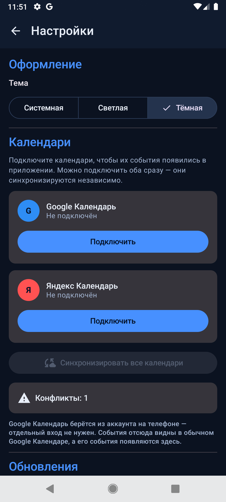 | 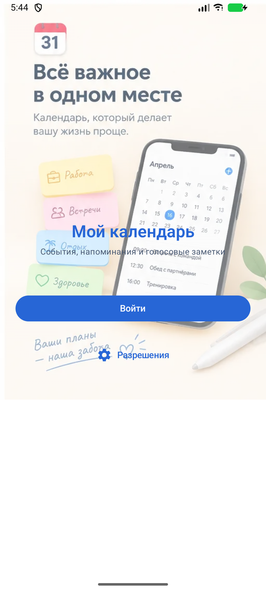 | |
| Подключение календарей | Экран входа | |

## Возможности

**Календарь**
- три режима: месяц, неделя, день; перелистывание по периодам, отметки дней с событиями;
- выбор нескольких напоминаний на событие: 5, 10, 15, 30 минут, час, день;
- повторы: ежедневно, еженедельно, ежемесячно, ежегодно;
- метки событий (день рождения, свидание, кино, врач, лекарства, отпуск), текстовые заметки
  и голосовые заметки (M4A,
  остаются на устройстве и не уходят в облако).

**Напоминания**
- точные будильники через `AlarmManager`; после перезагрузки расписание восстанавливается;
- уведомление с действиями «Открыть» и «Отложить» (на 10 минут); на заблокированном экране
  показывается полноэкранное напоминание, если пользователь выдал разрешение;
- экран разрешений: уведомления, микрофон, календарь, точные будильники, полноэкранные уведомления.

**Оформление**
- светлая, тёмная и системная тема по фиксированной палитре (без динамических цветов Material You);
- выбор хранится в DataStore.

**Синхронизация**
- Google — через `CalendarContract`, без OAuth: достаточно аккаунта Google на телефоне и
  разрешения на доступ к календарю;
- Яндекс — OAuth (`mycalendar://oauth`) и CalDAV: обнаружение календарей через `PROPFIND`,
  выборка событий через `REPORT calendar-query`, запись — `PUT`/`DELETE` с iCalendar;
- фоновая синхронизация раз в 6 часов (WorkManager) и кнопки ручной синхронизации;
- очередь конфликтов с разбором по полям.

**Обновления**
- проверка новых версий через GitHub Releases (без токена): релиз с APK предлагается скачать,
  а подпись архива сверяется с установленным приложением, чтобы не подменить APK чужим.

## Как устроена синхронизация

Каждая локальная строка хранит **предка** — `syncBase`, снимок полей на момент последней успешной
синхронизации (`SyncSnapshot`: название, описание, начало, конец, напоминания, повтор). Решатель
`SyncConflictResolver` сравнивает предка, локальную версию и облачную и выбирает одно из действий:

| Решение | Когда | Что происходит |
|---|---|---|
| `Skip` | ничего не изменилось | ничего |
| `Insert` | локального события нет | строка создаётся без конфликта |
| `ApplyRemote` | менялось только облако | облачные значения применяются к строке |
| `AutoMerge` | стороны правили **разные** поля | правки объединяются, каждая остаётся |
| `Conflict` | стороны правили **одно и то же** поле | событие попадает в очередь конфликтов |
| `Purge` / `PushDelete` | событие удалено в облаке / локально | строка удаляется либо tombstone уезжает в облако |

Разбор конфликтов идёт на отдельном экране: по каждому спорному полю видно локальное и облачное
значение, выбор делается отдельно для каждого поля. Непересекающиеся правки уже слиты приложением,
а разобранное состояние становится новым предком — от него считаются дальнейшие изменения.

| | |
|---|---|
| 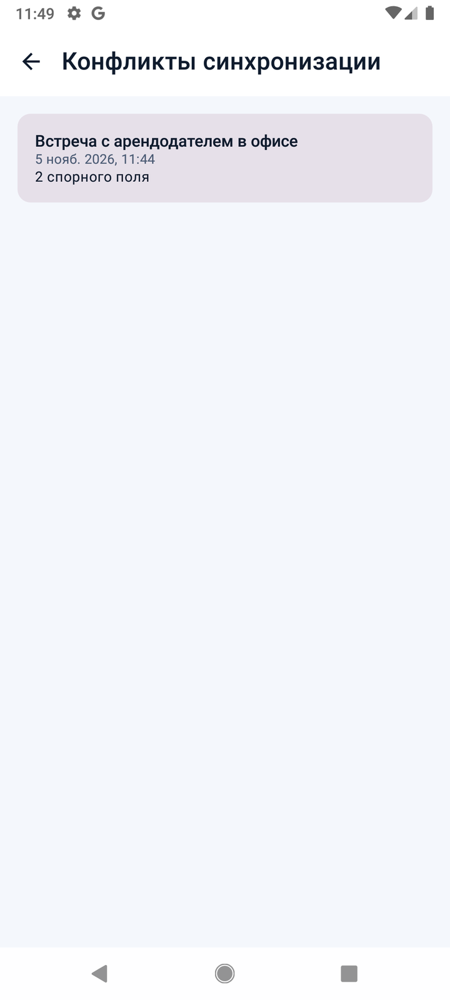 | 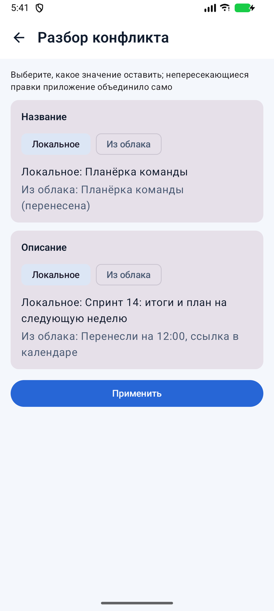 |
| Очередь конфликтов | Разбор по полям: локальное значение против облачного |

**Удаления.** Google отдаёт удаления явными строками `DELETED=1` — для него состав коллекции не
нужен. CalDAV tombstone'ов не присылает, поэтому для Яндекса удаление определяется по отсутствию
события в **полной** выборке коллекции. Чтобы не удалить данные из-за неполного ответа:

- `CalDavClient` прерывается с ошибкой, если в `multistatus` есть не-2xx `propstat` с `calendar-data`;
- состав коллекции считается достоверным, только если разобраны все `VEVENT` из ответа;
- если в отчёте нет ни одного локально привязанного события, синхронизация считает, что попала в
  другую коллекцию, и ничего не удаляет.

Исчезнувшее событие разбирается тем же трёхсторонним решателем: если локально его не правили —
строка удаляется молча, если правили — открывается конфликт-удаление с выбором «удалить везде» или
«вернуть из облака» (восстановление берёт последний согласованный снимок).

## Визуальный язык

Экраны собраны на единой navy-палитре: тёмно-синие поверхности, светлый текст, слева на каждой
карточке события — цветная полоса провайдера. Карточки событий применяются во всех режимах;
недельный вид — столбец из семи карточек дней, пустой день остаётся карточкой только с
заголовком. Палитра, отступы, радиусы и типографика заданы токенами в
`presentation/theme/Tokens.kt` и `Type.kt` — это единый источник стилей и для будущего
Windows-приложения. Контраст пары «текст на поверхности» проверяется тестом `PaletteContrastTest`,
а соответствие схемы navy-палитре — `ThemePaletteTest` на устройстве.

Выходные и праздничные дни тонированы: тон выходного и тон праздника отличаются оттенком, а праздник
несёт ещё и форму-маркер у даты. Будни тоже получают собственный голубой тон, а все клетки обведены
видимой рамкой — сетка читается как набор отдельных карточек. Все пары контраста поверх этих тонов
зафиксированы тестом `PaletteContrastTest` — оттенок в сетку не попадает, пока текст и маркер на нём
не читаются.

## Стек

| Слой | Технологии |
|---|---|
| Язык и сборка | Kotlin 2.3.21 (встроенный в AGP 9.4.1), Gradle 9.6, JDK 17 |
| UI | Jetpack Compose (BOM 2026.09.00), Material 3, Navigation Compose 2.10.2 |
| DI | Hilt 2.60.1 (включая Hilt Worker для WorkManager) |
| Данные | Room 2.8.5 (схемы экспортируются в `app/schemas`), DataStore Preferences |
| Сеть | Retrofit 3.0, OkHttp 5.5, kotlinx.serialization |
| Фон | WorkManager 2.12, AlarmManager, broadcast-приёмники |
| Производительность | Baseline Profile (`:baselineprofile`), R8 full mode |
| Тесты | JUnit 4, OkHttp MockWebServer, Compose UI Test, Room `MigrationTestHelper`, Hilt testing |

`minSdk 26`, `compileSdk`/`targetSdk 37`.

## Архитектура

Слои разделены по пакетам `data` → `domain` → `presentation`; навигация — единственный
`NavHost`, экраны получают состояние из ViewModel. Синхронизация — это отдельный сценарий
`SyncRepositoryImpl`, который работает поверх `EventRepository`, `ConflictRepository` и
провайдеров календарей (`RemoteCalendarDataSource`).

```
app/src/main/java/com/example/mycalendar/
├── data/            Room, DataStore, сеть, CalDAV, CalendarContract, OAuth, аудио
├── domain/          модели (Event, SyncSnapshot, SyncConflict), репозитории, use case'ы
├── presentation/    Compose-экраны, ViewModel'и, тема, навигация
├── notifications/   уведомления, полноэкранное напоминание, «Отложить»
├── work/            планировщик будильников, SyncWorker, приёмник загрузки
└── di/              Hilt-модули
```

## Сборка

Требования: **JDK 17** и Android SDK с платформой **API 37**. Путь к SDK — в `local.properties`
(`sdk.dir=...`), файл в репозиторий не попадает.

```bash
./gradlew :app:assembleDebug          # debug APK
./gradlew :app:assembleRelease        # release с R8 и shrinkResources
./gradlew :app:testDebugUnitTest      # JVM-тесты приложения
./gradlew :shared:test                # тесты общего модуля (домен, слияние, синхронизация)
./gradlew :desktopApp:test            # тесты desktop-клиента
./gradlew :app:lintDebug              # Android Lint
./gradlew :app:connectedDebugAndroidTest  # тесты на подключённом устройстве/эмуляторе
./gradlew :desktopApp:createDistributable # образ Windows-клиента со встроенной JRE
./gradlew :desktopApp:packageMsi          # MSI-установщик (нужен WiX 3 в PATH)
./gradlew :desktopApp:packageExe          # EXE-установщик
```

**Сборка MSI.** Отдельно ставить WiX не нужно: плагин Compose сам скачивает WiX 3.11 в
`~/.gradle/compose-jb/wix311.zip` при упаковке (нужна сеть на первом запуске). `jpackage` из
JDK 21 умеет только WiX 3 (`candle.exe`/`light.exe`), поэтому внешний WiX 4+ не подойдёт;
проверено и с внешним WiX 3.14.1 в `PATH` (портативно в `%LOCALAPPDATA%\wix314`) — это запасной
вариант для сборки без сети. Артефакты — в
`desktopApp/build/compose/binaries/main/{msi,exe}/MyCalendar-0.1.0.msi` (около 107 МиБ каждый).
MSI ставит программу для всех пользователей (Windows запросит права администратора), кладёт
ярлыки на рабочий стол и в меню «Пуск» (группа `MyCalendar`); `upgradeUuid` закреплён в
`build.gradle.kts`, поэтому следующая версия обновляет установленную, а не встаёт рядом.

**Подпись release.** Ключ читается из `keystore.properties` в корне проекта:

```properties
storeFile=release.jks
storePassword=...
keyAlias=...
keyPassword=...
```

Оба файла (`keystore.properties`, `*.jks`) в `.gitignore` — ключи и пароли в репозиторий не
попадают. Без `keystore.properties` release собирается **неподписанным**; debug-ключ для релиза
не подставляется. Если пароль указывает на несуществующий файл или в файле не хватает полей,
сборка падает с понятной ошибкой.

## Тесты

- **330 JVM-тестов** — 46 в Android-приложении, 104 в `:shared`, 180 в `:desktopApp`; решатель конфликтов, репозитории на фейках, CalDAV-клиент против локального
  mock-сервера (`MiniCalDavServer`, вместе с клиентом живёт в `:shared`), OAuth, планировщик напоминаний, сравнение версий и разбор
  ответа GitHub Releases; тонирование выходных и праздников покрыто реестром праздников
  (`HolidayRegistryTest`, 7), тоном дня (`DayMarkToneTest`, 3), контрастом пар палитры
  (`PaletteContrastTest`, 9 — две проверки про тон будней и видимость рамки) и границами сетки
  (`CalendarUiStateTest`, 4); сигнал напоминания и признак дня рождения — `BirthdayCalendarTest` (7)
  и `ReminderSoundPolicyTest` (6), имя коллекции из ответа источника — `YandexCalendarDataSourceTest`
  (6, из них 1 — `calendarName`); текст шапки недели — `WeekTitleTest` (4, включая недели
  на стыке месяцев и лет) и форма счётчика спорных полей — `ContestedFieldsLabelTest` (3);
  итог 330 и 0 падений: `testDebugUnitTest` — 46, `:shared:test` — 104, `:desktopApp:test` — 180
  (замер 13.11.2026); в `:shared` правила разбора конфликта живут отдельно от usecase —
  `ResolveConflictRuleTest` (8): матрица исходов удаления и состав разобранной записи;
  общее с Android правило выбора вхождения для напоминания — `ReminderOccurrenceHelperTest` (5):
  ещё не начавшееся событие само себе вхождение (и повтор с будущим началом тоже), начавшийся
  повтор переходит к следующему вхождению, прошедшее одиночное не даёт вхождения;
  в desktop-модуле — хранение событий файлом: сохранение переживает перезапуск,
  tombstone не виден выборкам, но остаётся в очереди отправки, привязка к провайдеру и снимок-предок
  переживают правку пользователя, повреждённый файл откладывается в сторону, параллельные записи
  не теряют события и не оставляют временных файлов, `%APPDATA%` резолвится в
  `MyCalendar\events.json`; настройки синхронизации, очередь конфликтов и аккаунт тоже файлами
  (`DesktopSettingsRepositoryTest`, 5; `DesktopConflictRepositoryTest`, 6; `DesktopAuthRepositoryTest`, 8),
  а общий движок синхронизации прогнан на этих хранилищах (`DesktopSyncEngineTest`, 3);
  вход через Яндекс по коду устройства проверен движком против локального HTTP-сервера
  (`DesktopYandexLoginTest`, 6): опрос токена до подтверждения, объяснение отказа сервера,
  истёкший код без лишних запросов, недоступный профиль без токена в сообщении, ошибки выдачи
  кода и разбора ответа; отмена входа остаётся отменой (`DesktopAuthRepositoryTest`);
  раскладка событий по дням проверена `DayDotsTest` (7): своё вхождение,
  переход через полночь, конец ровно в полночь, недельное повторение, порядок по времени начала,
  обрезка диапазоном сетки; список дня — `DayEventsTest` (6): время вхождения, конец ровно в полночь,
  длинное событие с настоящими границами, разворот недельного повторения, событие вне дня и порядок
  по времени начала; месячный вид проверен Compose UI-тестами (18): заголовок, навигация,
  «Сегодня», выбор дня с подписью праздника, форма-маркер праздника, легенда, точки событий
  с лимитом три на клетку и отсутствие точек без событий, список событий дня с временем,
  «Событий нет» для пустого дня, обновление списка при смене дня, открытая граница многодневного
  события, подпись повторения, шестерёнка, открывающая настройки, кнопка «+» в панели дня,
  клик по карточке, отдающий событие в вызывающего, появление панели события справа и её
  кнопка «Изменить»; сама панель — `EventInfoPanelUiTest` (4): название, дата дня и время,
  повтор, описание, заметка и метки, открытая граница с многоточием, кнопки «Изменить»,
  «Удалить» и «Закрыть»; настройки desktop-клиента —
  хранение `settings.json` (`DesktopSettingsStoreTest`, 5): умолчания без файла, сохранение
  переживает перезапуск (включая сворачивание в трей), повреждённый файл откладывается в сторону,
  без временных файлов, параллельные записи сериализуются; экран настроек (`SettingsScreenUiTest`, 15):
  секции и значения по умолчанию, выбор темы, тихий режим, флажок «Сворачивать в трей», кнопка
  «Назад», имя выбранного сигнала и «Сбросить», карточка Яндекса с подключённой и отключённой
  учётной записью, «Войти»/«Выйти» и показ ошибки входа, кнопка «Синхронизировать» с аккаунтом
  и без него, строка состояния и работа во время синхронизации, строка «Конфликты» скрыта при
  пустой очереди и открывает разбор при непустой; строка статуса —
  `SyncStatusTextTest` (7): «ещё не выполнялась», время последней, сводка «Готово», ошибка,
  частичный успех, «не подключён» и «Синхронизация…»; диалог с кодом устройства
  (`YandexLoginDialogUiTest`, 3): код и страница входа, копирование и отмена, ошибка открытия
  браузера внутри диалога; разбор конфликтов в окне — тексты (`ConflictTextsTest`, 10): формы
  счётчика спорных полей, тексты видов конфликта, значения полей с зоной, повторы, напоминания,
  короткая дата обнаружения без точки CLDR и пояснения к отказам; контроллер
  (`ConflictsControllerTest`, 7): открытие конфликта, выбор по спорным полям, запись с выбранным
  облачным значением и очисткой очереди, устаревший снимок и исчезнувшая локальная запись дают
  пояснение, исходы удаления, повторные нажатия во время записи; экран
  (`ConflictsScreenUiTest`, 7): пустая очередь, список и выбор конфликта, чипы полей и «Применить»,
  занятость записи, подтверждение «Удалить везде», «Создать заново в облаке» и скрытие пояснения;
  редактор события — черновик и проверка полей (`EventDraftTest`, 9): умолчания нового слота,
  сборка события, пустое название, неверные дата и время, конец не позже начала, сохранение
  локальных полей при правке (включая метки), разворот даты и времени в заданной зоне; диалог
  (`EventEditorUiTest`, 13): предзаполнение нового и существующего события, сохранение
  с изменёнными временем и повтором, три ошибки полей, сохранение идентификатора при правке,
  чекбоксы меток при создании и правке, отмена и удаление с подтверждением; напоминания
  desktop-клиента — чистое планирование (`ReminderPlannerTest`, 9): напоминание до начала,
  отсрочка 1,5 с при уже прошедшем времени и ещё не начавшемся событии, начавшееся и прошедшее
  без повтора не планируются, дубль минут схлопывается, первое вхождение повтора с будущим
  началом берётся само событие, повторное планирование и цепочка
  следующего вхождения; подписи (`ReminderTextsTest`, 5): «Начало в 09:30 (через 5 мин)»,
  часы, дни и «Событие начинается»; исполнитель на фейковом таймере
  (`DesktopReminderSchedulerTest`, 8): задержки, содержимое сработавшего напоминания,
  отмена при перепланировании и удалении, продолжение цепочки повтора после срабатывания;
  плашка (`ReminderBannerUiTest`, 3): название, подпись и кнопки «Открыть» и «Закрыть»;
- **75 instrumented-тестов** — Room-миграции, сквозные сценарии синхронизации на настоящей базе,
  экраны конфликтов, уведомления и действия, системный календарь, переиспользование OAuth-токена,
  сверка подписи скачанного APK на устройстве, карточки события и недельного вида, тон и
  маркер праздничного дня в месячной сетке и в шапке дня (`DayViewHolidayUiTest`, 6) и в карточках
  недели (`WeekViewCardsUiTest`, 6 — 1 тест добавлен этой серией), контраст палитры токенов;
  выбор сигнала и тихий режим — интент напоминания (`ReminderActivityIntentTest`, 4), тихий канал
  (`QuietModeChannelTest`, 4), оверлей тихого режима и «Отложить» (`OverlayQuietModeTest`, 1;
  `OverlaySnoozeTest`, 1), карточка «Напоминания» (`SettingsRemindersCardTest`, 2) и индикатор
  в шапке (`QuietModeIndicatorTest`, 1);
  итог 75 и 0 падений сняты с JUnit-отчёта `connectedDebugAndroidTest` (замер 12.11.2026);
- Lint — 0 ошибок, 17 предупреждений: дубли иконок xml/png, атрибуты,
  игнорируемые на старых API, `UseKtx` в новом коде и предложения обновить зависимости.

Connected-тесты выдают себе runtime-разрешения через `pm grant` — установка APK их не даёт. Без
`RECORD_AUDIO` тест записи голоса не стартовал, и это списывали на отсутствие микрофона у эмулятора,
хотя запись работает и на headless-образе с отключённым звуком.

Instrumented-тесты проходят на эмуляторах API 28 и API 37. Подпись тестового APK — debug; для
`connectedDebugAndroidTest` нужен запущенный эмулятор или устройство с включённой отладкой.

## Документация

Проектные документы лежат в репозитории:

- [дизайн сохранности данных при конфликтах](docs/superpowers/specs/2026-10-23-sync-conflict-safety-design.md);
- [план реализации](docs/superpowers/plans/2026-10-23-sync-conflict-safety.md);
- [как установить и что проверить](docs/how-to-verify.md).

## Ограничения

- Windows-клиент — в этом же репозитории: модуль `:shared` (домен, слияние, iCalendar,
  CalDAV-клиент, движок синхронизации) и заготовка
  `:desktopApp` на Compose Desktop с месячным видом: тона выходных и праздников, маркер праздника,
  точки событий по провайдерам (как на Android, не больше трёх на клетку), список событий
  выбранного дня под сеткой и фирменный градиент в шапке карточки события. Клик по карточке в
  списке дня открывает справа панель события: дата дня, время (открытая граница — многоточием),
  повтор, описание, заметка, метки, кнопки «Изменить» и «Удалить»; редактор открывается только
  из панели, а не по клику на карточку. Кнопка «+» в панели дня открывает редактор нового события:
  название, дата, время начала и конца, повтор; правка повторяющегося события меняет серию,
  удаление спрашивает подтверждение. Шестерёнка в шапке открывает настройки в духе Android:
  тема (системная / светлая / тёмная), тихий режим и сигналы напоминаний, флажок «Сворачивать в
  трей» — с ним крестик окна прячет программу в трей, а не завершает её (меню иконки: «Открыть»,
  «Выход»), версия и путь к данным. Настройки desktop-клиента хранятся файлом
  `%APPDATA%\MyCalendar\settings.json` (вне Windows — `~/.mycalendar/settings.json`); события — в
  `%APPDATA%\MyCalendar\events.json` (вне Windows — `~/.mycalendar/events.json`). Рядом лежат
  `conflicts.json` (очередь конфликтов) и `account.json` (учётные записи без токена): кнопка
  «Синхронизировать» в карточке «Календари» запускает общий движок на этих хранилищах, а строка
  под ней показывает итог в формулировках Android («Готово: отправлено …, получено …, конфликтов …»)
  или время последней синхронизации после перезапуска. Открытая очередь видна там же строкой
  «Конфликты: N» с кнопкой «Разобрать»: экран разбора повторяет Android — слева список конфликтов,
  справа выбранный; спорные поля переключаются чипами «Локальное»/«Из облака», удаления
  разбираются исходами «Удалить везде» (с подтверждением) и «Вернуть из облака»/«Создать заново
  в облаке». Перед записью очередь перечитывается: если она успела измениться, выбор не применяется
  и экран объясняет, что конфликт нужно открыть заново. Вход через
  Яндекс работает по коду устройства: карточка «Яндекс» в настройках
  показывает код, копирует его и открывает `https://ya.ru/device` в браузере, приложение опрашивает
  токен до истечения кода (5 минут); токен живёт только в памяти, без записей на диск и в файлы.
  Напоминания desktop-клиент доставляет, пока сам запущен: при старте расписание строится по
  будущим событиям, сохранение и удаление события перепланируют его, а в момент срабатывания
  вверху окна появляется плашка «Начало в 09:30 (через 5 мин)» с кнопками «Открыть» (переход
  к дню события) и «Закрыть», окно разворачивается из трея и играет сигнал — выбранный файл,
  если формат WAV/AU/AIFF, иначе системный писк; в тихом режиме плашка молчит. Повторяющееся
  событие после срабатывания сразу планирует следующее вхождение. Откладывания нет, автозапуска
  с Windows нет, и при закрытой программе напоминание не придёт.
- Обновления ищутся в GitHub Releases репозитория `zanzibara82/calendar`: пока релиз не опубликован,
  приложение честно отвечает «Опубликованных релизов пока нет».
- Google-синхронизация работает через системный календарь, поэтому требует добавленного аккаунта
  Google на устройстве; OAuth-клиент и регистрация в Google Cloud Console не нужны.
- Для Яндекса нужен `YANDEX_CLIENT_ID` в `data/auth/OAuthConfig.kt` и приложение, зарегистрированное
  в Яндекс OAuth с callback `mycalendar://oauth`.
