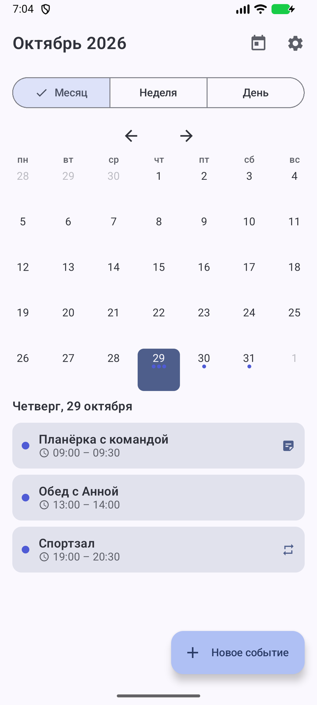
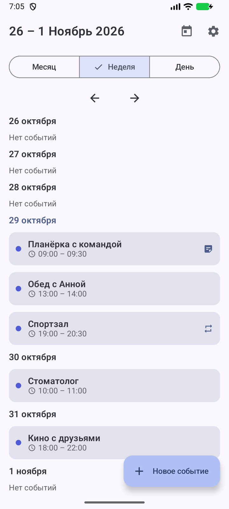
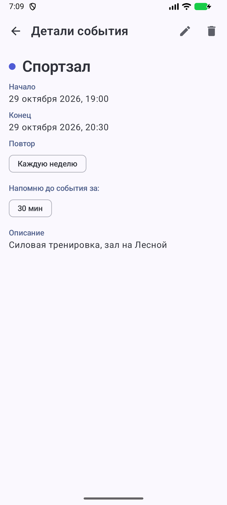
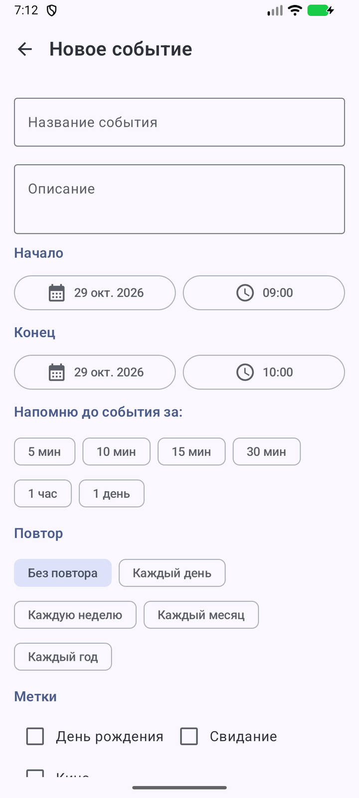
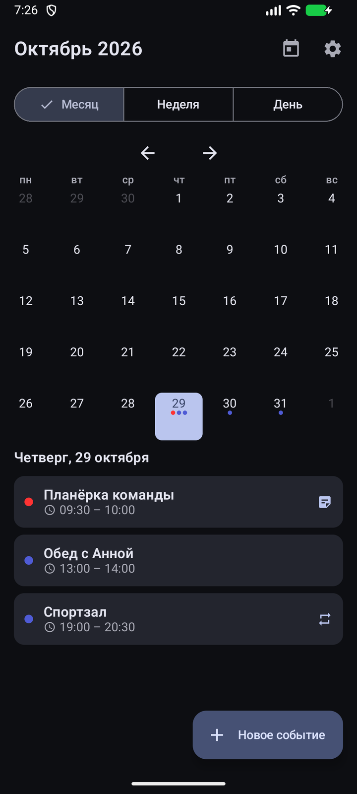
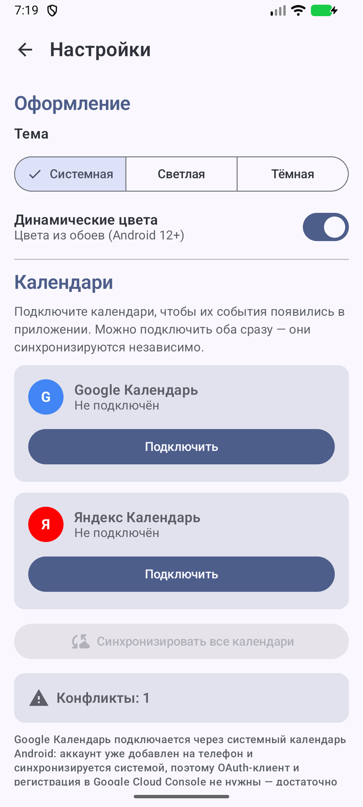
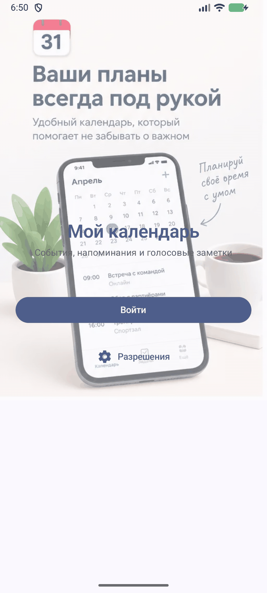
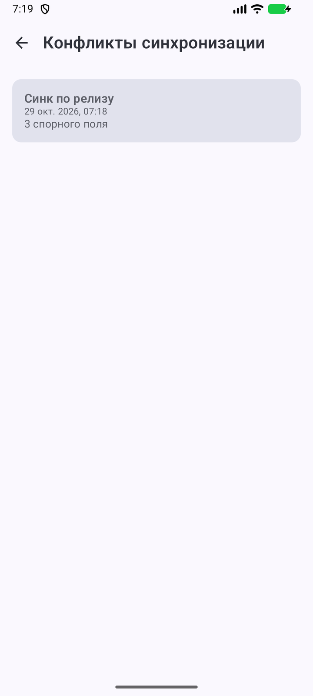
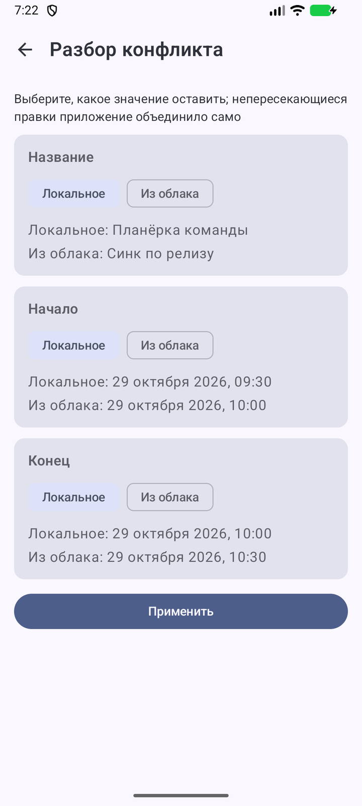

# Мой календарь

Android-календарь на Kotlin и Jetpack Compose: месяцы, недели и дни, события с напоминаниями,
повторами, метками, текстовыми и голосовыми заметками. События хранятся локально (Room) и
синхронизируются с **Google Календарём** через системный провайдер и с **Яндекс Календарём** по
CalDAV — в обе стороны.

Главное отличие от «ещё одного календаря» — **сохранность данных при конфликтах**: приложение
помнит последнее согласованное с облаком состояние каждого события, поэтому правки с двух сторон
не затирают друг друга, а раскладываются по полям и разбираются пользователем.

| | |
|---|---|
|  |  |
| Месяц с событиями | Неделя |
|  |  |
| Детали события с повтором | Редактор события |

| | | |
|---|---|---|
|  |  |  |
| Тёмная тема | Подключение календарей | Экран входа |

## Возможности

**Календарь**
- три режима: месяц, неделя, день; перелистывание по периодам, отметки дней с событиями;
- выбор нескольких напоминаний на событие: 5, 10, 15, 30 минут, час, день;
- повторы: ежедневно, еженедельно, ежемесячно, ежегодно;
- метки событий (день рождения, свидание, кино), текстовые заметки и голосовые заметки (M4A,
  остаются на устройстве и не уходят в облако).

**Напоминания**
- точные будильники через `AlarmManager`; после перезагрузки расписание восстанавливается;
- уведомление с действиями «Открыть» и «Отложить» (на 10 минут); на заблокированном экране
  показывается полноэкранное напоминание, если пользователь выдал разрешение;
- экран разрешений: уведомления, микрофон, календарь, точные будильники, полноэкранные уведомления.

**Оформление**
- светлая, тёмная и системная тема, динамические цвета на Android 12+;
- выбор хранится в DataStore.

**Синхронизация**
- Google — через `CalendarContract`, без OAuth: достаточно аккаунта Google на телефоне и
  разрешения на доступ к календарю;
- Яндекс — OAuth (`mycalendar://oauth`) и CalDAV: обнаружение календарей через `PROPFIND`,
  выборка событий через `REPORT calendar-query`, запись — `PUT`/`DELETE` с iCalendar;
- фоновая синхронизация раз в 6 часов (WorkManager) и кнопки ручной синхронизации;
- очередь конфликтов с разбором по полям.

**Обновления**
- проверка новых версий через GitHub Releases (без токена): релиз с APK предлагается скачать,
  а подпись архива сверяется с установленным приложением, чтобы не подменить APK чужим.

## Как устроена синхронизация

Каждая локальная строка хранит **предка** — `syncBase`, снимок полей на момент последней успешной
синхронизации (`SyncSnapshot`: название, описание, начало, конец, напоминания, повтор). Решатель
`SyncConflictResolver` сравнивает предка, локальную версию и облачную и выбирает одно из действий:

| Решение | Когда | Что происходит |
|---|---|---|
| `Skip` | ничего не изменилось | ничего |
| `Insert` | локального события нет | строка создаётся без конфликта |
| `ApplyRemote` | менялось только облако | облачные значения применяются к строке |
| `AutoMerge` | стороны правили **разные** поля | правки объединяются, каждая остаётся |
| `Conflict` | стороны правили **одно и то же** поле | событие попадает в очередь конфликтов |
| `Purge` / `PushDelete` | событие удалено в облаке / локально | строка удаляется либо tombstone уезжает в облако |

Разбор конфликтов идёт на отдельном экране: по каждому спорному полю видно локальное и облачное
значение, выбор делается отдельно для каждого поля. Непересекающиеся правки уже слиты приложением,
а разобранное состояние становится новым предком — от него считаются дальнейшие изменения.

| | |
|---|---|
|  |  |
| Очередь конфликтов | Разбор по полям: локальное значение против облачного |

**Удаления.** Google отдаёт удаления явными строками `DELETED=1` — для него состав коллекции не
нужен. CalDAV tombstone'ов не присылает, поэтому для Яндекса удаление определяется по отсутствию
события в **полной** выборке коллекции. Чтобы не удалить данные из-за неполного ответа:

- `CalDavClient` прерывается с ошибкой, если в `multistatus` есть не-2xx `propstat` с `calendar-data`;
- состав коллекции считается достоверным, только если разобраны все `VEVENT` из ответа;
- если в отчёте нет ни одного локально привязанного события, синхронизация считает, что попала в
  другую коллекцию, и ничего не удаляет.

Исчезнувшее событие разбирается тем же трёхсторонним решателем: если локально его не правили —
строка удаляется молча, если правили — открывается конфликт-удаление с выбором «удалить везде» или
«вернуть из облака» (восстановление берёт последний согласованный снимок).

## Стек

| Слой | Технологии |
|---|---|
| Язык и сборка | Kotlin 2.3.21 (встроенный в AGP 9.4.1), Gradle 9.6, JDK 17 |
| UI | Jetpack Compose (BOM 2026.09.00), Material 3, Navigation Compose 2.10.2 |
| DI | Hilt 2.60.1 (включая Hilt Worker для WorkManager) |
| Данные | Room 2.8.5 (схемы экспортируются в `app/schemas`), DataStore Preferences |
| Сеть | Retrofit 3.0, OkHttp 5.5, kotlinx.serialization |
| Фон | WorkManager 2.12, AlarmManager, broadcast-приёмники |
| Производительность | Baseline Profile (`:baselineprofile`), R8 full mode |
| Тесты | JUnit 4, OkHttp MockWebServer, Compose UI Test, Room `MigrationTestHelper`, Hilt testing |

`minSdk 26`, `compileSdk`/`targetSdk 37`.

## Архитектура

Слои разделены по пакетам `data` → `domain` → `presentation`; навигация — единственный
`NavHost`, экраны получают состояние из ViewModel. Синхронизация — это отдельный сценарий
`SyncRepositoryImpl`, который работает поверх `EventRepository`, `ConflictRepository` и
провайдеров календарей (`RemoteCalendarDataSource`).

```
app/src/main/java/com/example/mycalendar/
├── data/            Room, DataStore, сеть, CalDAV, CalendarContract, OAuth, аудио
├── domain/          модели (Event, SyncSnapshot, SyncConflict), репозитории, use case'ы
├── presentation/    Compose-экраны, ViewModel'и, тема, навигация
├── notifications/   уведомления, полноэкранное напоминание, «Отложить»
├── work/            планировщик будильников, SyncWorker, приёмник загрузки
└── di/              Hilt-модули
```

## Сборка

Требования: **JDK 17** и Android SDK с платформой **API 37**. Путь к SDK — в `local.properties`
(`sdk.dir=...`), файл в репозиторий не попадает.

```bash
./gradlew :app:assembleDebug          # debug APK
./gradlew :app:assembleRelease        # release с R8 и shrinkResources
./gradlew :app:testDebugUnitTest      # JVM-тесты
./gradlew :app:lintDebug              # Android Lint
./gradlew :app:connectedDebugAndroidTest  # тесты на подключённом устройстве/эмуляторе
```

**Подпись release.** Ключ читается из `keystore.properties` в корне проекта:

```properties
storeFile=release.jks
storePassword=...
keyAlias=...
keyPassword=...
```

Оба файла (`keystore.properties`, `*.jks`) в `.gitignore` — ключи и пароли в репозиторий не
попадают. Без `keystore.properties` release собирается **неподписанным**; debug-ключ для релиза
не подставляется. Если пароль указывает на несуществующий файл или в файле не хватает полей,
сборка падает с понятной ошибкой.

## Тесты

- **97 JVM-тестов** — решатель конфликтов, репозитории на фейках, CalDAV-клиент против локального
  mock-сервера (`MiniCalDavServer`), OAuth, планировщик напоминаний, сравнение версий и разбор
  ответа GitHub Releases;
- **41 instrumented-тест** — Room-миграции, сквозные сценарии синхронизации на настоящей базе,
  экраны конфликтов, уведомления и действия, системный календарь, переиспользование OAuth-токена,
  сверка подписи скачанного APK на устройстве;
- Lint — 0 ошибок.

Instrumented-тесты проходят на эмуляторах API 28 и API 37. Подпись тестового APK — debug; для
`connectedDebugAndroidTest` нужен запущенный эмулятор или устройство с включённой отладкой.

## Документация

Проектные документы лежат в репозитории:

- [дизайн сохранности данных при конфликтах](docs/superpowers/specs/2026-10-23-sync-conflict-safety-design.md);
- [план реализации](docs/superpowers/plans/2026-10-23-sync-conflict-safety.md);
- [как установить и что проверить](docs/how-to-verify.md).

## Ограничения

- Windows-клиент в планах отдельным репозиторием; здесь только Android.
- Обновления ищутся в GitHub Releases репозитория `zanzibara82/calendar`: пока релиз не опубликован,
  приложение честно отвечает «Опубликованных релизов пока нет».
- Google-синхронизация работает через системный календарь, поэтому требует добавленного аккаунта
  Google на устройстве; OAuth-клиент и регистрация в Google Cloud Console не нужны.
- Для Яндекса нужен `YANDEX_CLIENT_ID` в `data/auth/OAuthConfig.kt` и приложение, зарегистрированное
  в Яндекс OAuth с callback `mycalendar://oauth`.
